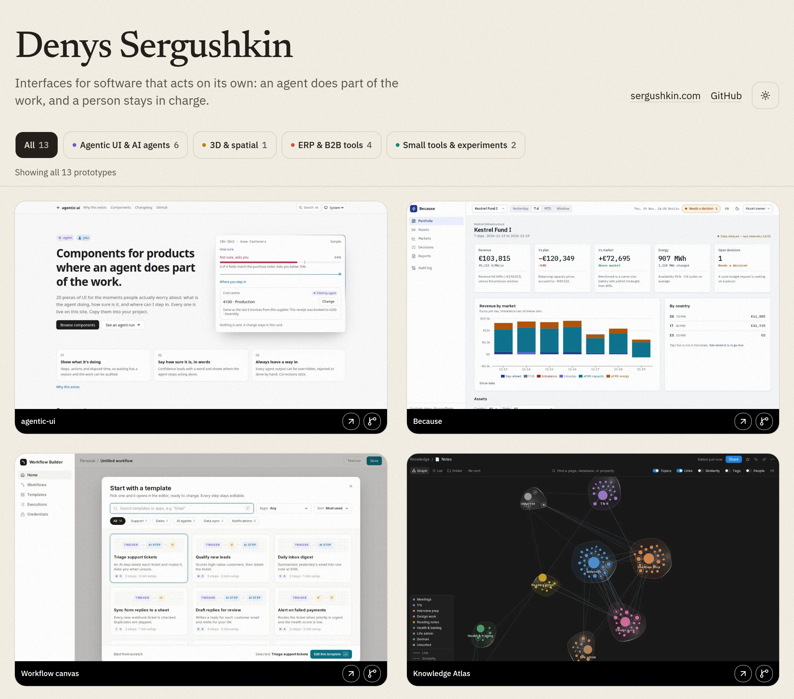
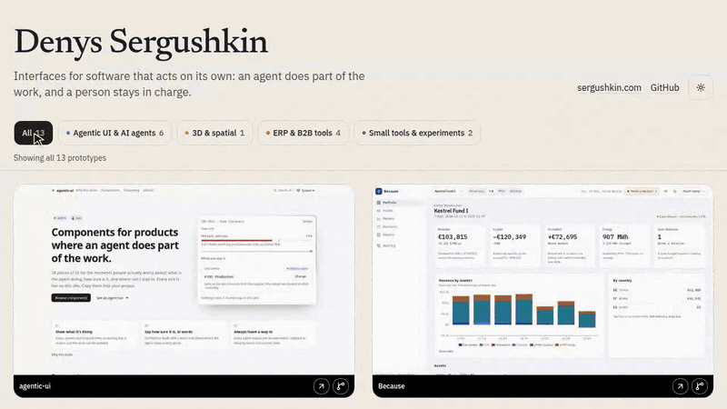

# Projects gallery

A single page of Denys Sergushkin’s live prototypes. The topics are the same groups as on the [profile README](https://github.com/sergushkincom/sergushkincom#by-topic). Pick one or more, and the address bar keeps the choice.

Live: https://projects-gallery-pi.vercel.app

## Add a project

1. Open the live URL and confirm it returns 200. If it does not, leave it out.
2. Put a 1280×640 image at `public/cards/card-<repo>.jpg`.
3. Add one entry to `data/projects.ts`: name, one-line description, topics, live URL, repo URL, image, and image alt.
4. If you add a new topic id, add a matching line in `app/globals.css` under the `html[data-topics]` rules.
5. Open a pull request. CI typechecks, lints, and builds.

Do not add healthcare-ui.
